<picture>
  <source media="(prefers-color-scheme: dark)" srcset="assets/header-dark.svg">
  
</picture>

### Education

**BSc Artificial Intelligence & Data Science**, Middlesex University Dubai · 2025 – 2028 (expected)

### Skills

- **AI/ML:** LLM pipelines with structured outputs, prompt design, embeddings and semantic search, retrieval evaluation, NLP with transformers
- **Data:** SQL, statistical testing (A/B tests, confidence intervals, meta-analysis), exploratory analysis, data visualisation
- **Web:** full-stack apps, REST APIs, server-side rendering, responsive UI

### Stack

### Contact

